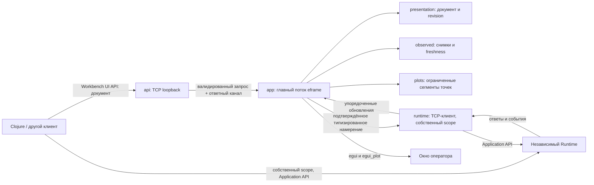

# Архитектурное предложение: независимый lab-workbench

Статус: **предложение для ревью; реализация не начата**. Дата: 20 октября 2026 года.
Рабочий репозиторий: `D:\rust_projects\lab-workbench`, исходно пустой, ветка `main`.

## 1. Рекомендация и границы первой версии

Один самостоятельный Rust executable, одно основное окно `eframe`, обычные виджеты
`egui` и графики `egui_plot`. Главный поток владеет отображаемой моделью. Один
дополнительный поток с Tokio обслуживает TCP-клиент Runtime и TCP-сервер Workbench.
Между потоками — ограниченные каналы. Ни отдельного GUI-процесса, ни собственного
renderer, ни брокера, ни базы Workbench.

Внешний клиент передаёт небольшой типизированный документ интерфейса. Workbench
сам получает данные и изменения состояния из Application API Runtime. Применение
документа **никогда не исполняет управляющие действия**. Действие возникает только
из явного операторского подтверждения в GUI. Внешний клиент продолжает управлять
Runtime через свою независимую сессию.

Первая полноценная версия поддерживает один Runtime, несколько графиков и панелей,
live-наблюдение, reconnect, управление Reference/PID/Recorder и явное ручное управление
декларированным выходом. Архивная история необязательна; её отсутствие не мешает live.
Плагины, скрипты, произвольные выражения, универсальный редактор раскладки и
автоматическое восстановление прежнего GUI-сеанса не входят в эту версию.

Ключевые результаты исследования:

1. Application API предоставляет нужные операции, но не общий атомарный снимок
   всего эксперимента. Нужно согласование отдельных снимков с потоком событий.
2. `accepted`, terminal result, фактическое состояние и физический эффект —
   разные свидетельства. Ни одно не подменяет остальные.
3. У виртуальной печи температура является сигналом, а `heater_power` — actuator
   **без измерительного сигнала**. Для графика мощности нужен явно обозначенный
   источник `output.readback`, см. раздел 9.
4. `scope` Workbench и Clojure различаются. Чужая ручная lease не становится
   полномочием Workbench от чтения `output` или передачи UI-документа.
5. События Recorder сообщают изменения lifecycle, но не каждое продвижение
   durability-счётчиков. Для последних нужен редкий запрос состояния.

## 2. Основание предложения

Изучены снимки `main`, полученные через GitHub API и архивы исходников. Архивы
распакованы только в `D:\lab-workbench-sandbox\architecture-20261020\`; дополнительных
Git-репозиториев не создавалось. Исходные проекты не изменялись и не собирались.

| Источник | Зафиксированный commit | Роль |
|---|---|---|
| [lab-runtime](https://github.com/alexandervolkov1/lab-runtime/tree/efaefd15d018128c047634c34102ec5730a683c4) | `efaefd15d018128c047634c34102ec5730a683c4` | Обязательный Application-контракт |
| [lab-runtime-legacy](https://github.com/alexandervolkov1/lab-runtime-legacy/tree/5f357933566fb5cf6c6a7c131d9e149aa1999039) | `5f357933566fb5cf6c6a7c131d9e149aa1999039` | Только кандидаты отдельных функций |
| [com_port_reader](https://github.com/alexandervolkov1/com_port_reader/tree/09bae53386756fcf79df7a3ff3bfbc39bb2e8cfc) | `09bae53386756fcf79df7a3ff3bfbc39bb2e8cfc` | Только алгоритмы и приёмы GUI |

Веб-представление README актуального репозитория оказалось устаревшим относительно
архива commit: оно описывало прежние два приложения. Выводы ниже сделаны по
зафиксированным исходникам и текущей документации в архиве.

Основные источники контракта:

- [Протокол и сессии](https://github.com/alexandervolkov1/lab-runtime/blob/efaefd15d018128c047634c34102ec5730a683c4/docs/api/protocol-and-sessions.md):
  envelope, hello, scope, последовательность мутаций, time anchor.
- [Операции](https://github.com/alexandervolkov1/lab-runtime/blob/efaefd15d018128c047634c34102ec5730a683c4/docs/api/operations.md)
  и [registry](https://github.com/alexandervolkov1/lab-runtime/blob/efaefd15d018128c047634c34102ec5730a683c4/apps/lab-runtime/src/protocol.rs):
  47 операций, 22 query и 25 mutation; availability и ограничения.
- [Events/recovery](https://github.com/alexandervolkov1/lab-runtime/blob/efaefd15d018128c047634c34102ec5730a683c4/docs/api/events-mutations-and-recovery.md),
  [delivery.rs](https://github.com/alexandervolkov1/lab-runtime/blob/efaefd15d018128c047634c34102ec5730a683c4/apps/lab-runtime/src/application/delivery.rs)
  и [subscription_recovery.rs](https://github.com/alexandervolkov1/lab-runtime/blob/efaefd15d018128c047634c34102ec5730a683c4/apps/lab-runtime/tests/subscription_recovery.rs):
  замороженные страницы, общий slot, cursor, replay, gap.
- [discovery.rs](https://github.com/alexandervolkov1/lab-runtime/blob/efaefd15d018128c047634c34102ec5730a683c4/apps/lab-runtime/src/application/discovery.rs),
  [measurements.rs](https://github.com/alexandervolkov1/lab-runtime/blob/efaefd15d018128c047634c34102ec5730a683c4/apps/lab-runtime/src/measurements.rs),
  [projections.rs](https://github.com/alexandervolkov1/lab-runtime/blob/efaefd15d018128c047634c34102ec5730a683c4/apps/lab-runtime/src/application/projections.rs):
  реальные JSON-поля, signal identity, quality, generation, контроллеры и outputs.
- [Manual output](https://github.com/alexandervolkov1/lab-runtime/blob/efaefd15d018128c047634c34102ec5730a683c4/docs/api/manual-output.md),
  [outputs.rs](https://github.com/alexandervolkov1/lab-runtime/blob/efaefd15d018128c047634c34102ec5730a683c4/apps/lab-runtime/src/application/outputs.rs)
  и [manual_output_api.rs](https://github.com/alexandervolkov1/lab-runtime/blob/efaefd15d018128c047634c34102ec5730a683c4/apps/lab-runtime/tests/manual_output_api.rs):
  scope ownership, lease, fences, конечные receipts.
- [recorder_api.rs](https://github.com/alexandervolkov1/lab-runtime/blob/efaefd15d018128c047634c34102ec5730a683c4/apps/lab-runtime/src/recorder_api.rs),
  [recording.rs](https://github.com/alexandervolkov1/lab-runtime/blob/efaefd15d018128c047634c34102ec5730a683c4/apps/lab-runtime/src/application/recording.rs),
  [ошибки и лимиты](https://github.com/alexandervolkov1/lab-runtime/blob/efaefd15d018128c047634c34102ec5730a683c4/docs/api/errors-and-limits.md):
  статус без Recorder, история через API, retained operation outcomes.

Также просмотрены `application.rs`, `events.rs`, `sessions.rs`,
`application/{references,controllers}.rs`, `configuration_api.rs`,
`tests/{measurement_api,control_api,api_owner_queries,recorder_api}.rs`,
`clients/babashka-smoke/manual-output.clj` (framing/deadlines, subscription,
manual output, PID и Recorder workflow), руководство и `examples/runtime.virtual.toml`.
Внутренний `plant.rs` использован только для проверки того, что опубликованный
descriptor действительно не содержит signal у мощности. Ни один внутренний
Rust-тип Runtime не предлагается импортировать в Workbench.

В текущих API-документах сохранились описания старого Workbench, включая journal,
Exact Retry и старые клиентские лимиты. Это не требования нового приложения.
Ограничения Runtime и wire-семантика сохраняются; клиентский lifecycle проектируется
заново.

## 3. Потоки данных, модули и владение



Один Cargo package. Предполагаемая организация, **файлы реализации сейчас не создаются**:

| Модуль | Ответственность и состояние | Зачем отдельный |
|---|---|---|
| `app.rs` | `eframe::App`, панели/виджеты, применение входных сообщений, временные drafts, подтверждения, сбор намерений | Единственная точка владения GUI и последовательного применения изменений |
| `presentation.rs` | Serde DTO документа, binding/action enum, структурная валидация, replace/patch и revision | Нужен общий контракт для локального редактирования и внешнего API |
| `runtime/` | Собственные wire DTO, TCP framing, hello, запросы, подписка, bootstrap/reconnect, pending request identities; перевод типизированных действий в wire | Изолирует изменяемый внешний контракт и сетевые ожидания от GUI |
| `observed.rs` | Только наблюдаемые факты: каталог, значения, состояния, метки актуальности; reducer снимков и событий | Отделяет полученное состояние от документа и позволяет тестировать согласование без окна |
| `plots.rs` | Буферы по источнику, сегменты/разрывы, время и подготовка стандартных `Line`/`Points` | У графиков отдельные правила ограничений и непрерывности данных |
| `api.rs` | Loopback listener, framing и envelopes UI API, передача команд главному потоку, выдача результатов | Это другой протокол, с другими правами и лимитами |

`main.rs` — только запуск окна, фонового потока и shutdown. Не вводить отдельно
domain/event bus, store framework, renderer, generic repository, scheduler,
authority manager, connection registry или систему service traits. Разделение
`runtime/` на `wire.rs` и `client.rs` допустимо по размеру; отдельные crates не нужны.
Маршрутизация действий — обычный `match` внутри `runtime`, не ещё один сервис.

**Владельцы:**

- Runtime единолично владеет экспериментом, устройствами, контроллерами, безопасностью,
  Recorder и SQLite.
- `app` единолично меняет документ, наблюдаемую GUI-модель, буферы и drafts.
  `presentation`, `observed`, `plots` — её составные данные/функции, не фоновые actors.
- Сетевая задача Runtime владеет socket, `scope`, `next_seq`, картой запросов и
  временным bootstrap-набором. Он нужен лишь до атомарной установки в GUI.
- API task не хранит вторую копию изменяемого документа. Запросы get/replace/patch
  получает и последовательно исполняет главный поток.
- Никакие данные между потоками не разделяются через `Arc<Mutex<WorkbenchApp>>`.
  Используются owned DTO и небольшие каналы.

### 3.1. Штатный цикл GUI

Проверенные на дату исследования версии: `eframe/egui 0.37.0`,
`egui_plot 0.38.0`; metadata последнего указывает зависимость `egui ^0.37.0`.
Это совместимый кандидат, а не выполненная проверка сборкой. Версии и MSRV
проверить и закрепить в Cargo.lock на первом этапе реализации.
В этом API `eframe::App` имеет `logic` и `ui`, поэтому не закладываться на
сигнатуру `update` из старых примеров.

`logic` ограниченно осушает каналы и применяет изменения; `ui` строит стандартные
панели и графики. Фоновый поток вызывает `Context::request_repaint` после появления
работы. `logic` вызывается и при скрытом окне при запросе repaint — это важно,
чтобы свёрнутое окно продолжало принимать конфигурацию. Штатную egui multipass-логику
считать причиной отделить обработку команд от построения виджетов: намерения UI
получают локальный ID, повтор одного подтверждения в том же кадре не исполняется.
[Документация App](https://docs.rs/eframe/0.37.0/eframe/trait.App.html),
[Context](https://docs.rs/egui/0.37.0/egui/struct.Context.html).

На кадре нет blocking I/O, `await`, socket read, ожидания подтверждения Runtime,
SQL и длинных вычислений. Для live-данных достаточно до 30 repaint/s; индикаторы
возраста обновляются таймером. Неподвижный UI без данных не нуждается в постоянном
60-Hz loop. Транспорт принимает все сообщения независимо от частоты отрисовки.

Стартовые зависимости: `eframe` со штатным backend (предложение: `glow`),
`egui_plot`, `serde`, `serde_json`, `tokio` (`rt`, `net`, `time`, `sync`, `io-util`),
`tokio-util` для bounded framing/cancellation, `tracing`, `tracing-subscriber`,
`uuid` для instance ID. `egui` использовать через `eframe::egui`, если отдельная
прямая зависимость не нужна. Один Tokio `new_current_thread` в выделенном OS-потоке
достаточен; IO-задачи не блокируют его. `egui_extras`, календарный crate и
прореживание добавлять только при реальной потребности.
[Tokio Builder](https://docs.rs/tokio/latest/tokio/runtime/struct.Builder.html),
[LinesCodec](https://docs.rs/tokio-util/latest/tokio_util/codec/struct.LinesCodec.html).

Persistence feature `eframe` не включать. Не переносить GPU handles, texture owners,
raw input hooks или собственные plot geometry items. Панели, `ScrollArea`, `Grid`,
`Plot`, `Line`, `Points`, легенда, zoom и drag обеспечиваются библиотеками.
[egui_plot](https://docs.rs/egui_plot/0.38.0/egui_plot/).

## 4. Workbench UI API

### 4.1. Транспорт и минимальные операции

Рекомендация: TCP/NDJSON на `127.0.0.1:7421`, порт настраивается при запуске.
Это отдельный listener, не порт Runtime `7420`. При занятом порте окно работает,
но показывает ошибку UI API; не выбирать скрытно другой порт. Первая версия
принимает доверенные локальные программы, не публикует listener на LAN.
Loopback не является разграничением доступа между пользователями одной машины.
Если такое разграничение понадобится, отдельным решением добавить token/OS IPC;
для текущей однопользовательской модели это не требуется.

| Вариант | Оценка |
|---|---|
| TCP/NDJSON | Прямой доступ из Clojure/Java, простые framing и диагностика; рекомендуется |
| HTTP с JSON | Хорош для браузера и готовых web-клиентов, но сейчас добавляет стек без нужной функции |
| WebSocket | Нужен браузеру или web deployment; не нужен первому native-клиенту |
| Named pipe / Unix socket | Может дать OS ACL; усложняет переносимость и Clojure-клиент |

UTF-8, один JSON object + LF; CRLF допускается. TCP read не равен сообщению.
Обязателен hello первым сообщением. Envelope `v:1`, непустой `id` до 64 ASCII
символов, `op`, `args`. ID коррелирует ответ; это не Runtime `request_id`.
Неизвестные поля запросов и duplicate keys отклоняются. Ответы допускают
неизвестные добавочные поля; неизвестная major-версия — явная ошибка.

| Операция | Результат |
|---|---|
| `hello` | protocol/schema version, instance ID процесса Workbench, текущая revision, лимиты |
| `document.get` | Точный документ, instance ID и revision |
| `document.replace` | Полностью проверить и атомарно заменить документ |
| `document.patch` | Атомарная последовательность небольшого набора типизированных изменений |
| `status.get` | Состояние Workbench, UI API и Runtime-соединения, unresolved bindings, revision |

`runtime.invoke`, `control.click`, инъекции измерений и scripts отсутствуют.
Подписку на изменения самого документа пока не вводить: клиент может получить
`document.get` после конфликта или по необходимости. События эксперимента он
получает через собственный Runtime API.

```json
{"v":1,"id":"hello-1","op":"hello","args":{"protocol":"lab-workbench.ui","schema_version":1}}
```

Пример ответа:

```json
{"v":1,"id":"hello-1","type":"result","result":{"protocol":"lab-workbench.ui","schema_version":1,"instance_id":"8b46c671-1b4b-4b3e-9b06-267fa32c2749","revision":"0","limits":{"frame_bytes":1048576,"document_bytes":524288,"plots":32,"curves":128,"panels":32,"controls":256}}}
```

Все следующие идентификаторы instance в примерах иллюстративны; клиент использует
полученный hello. Workbench revision — десятичная строка `u64`, начинается с `"0"`
для пустого документа, увеличивается ровно на один при успешной мутации документа,
включая замену равным документом. Переполнение запрещает дальнейшие изменения.
У `document.replace/patch` обязательны `instance_id` и `base_revision`. Возврат
успеха означает применение к GUI-модели, не завершение GPU-кадра и не операцию Runtime.

### 4.2. Документ и IDs

Корень документа: `schema_version`, `title`, `plots`, `panels`.
Раскладка v1 фиксирована: верхняя строка связи/ошибок, слева панели в порядке массива,
в центре вертикальный список графиков в порядке массива. Высота графика может быть
настроена в допустимом диапазоне; произвольные деревья layout и native windows
не нужны. Пустые `plots` и `panels` допустимы.

ID графика, кривой, панели и control глобально уникален в документе:
`[A-Za-z][A-Za-z0-9_.-]{0,63}`. Подпись можно менять без смены ID. Индекс массива
никогда не является identity. Runtime IDs — отдельные канонические decimal strings.
`runtime:"primary"` обозначает единственное подключение, выбранное оператором/CLI;
документ не меняет адрес Runtime и не передаёт scope.

Bindings типизированы:

| Источник | Поля/смысл |
|---|---|
| `signal` | `signal:{instrument,parameter}`, `field:value/status/quality`; график — только numeric value |
| `output` | `actuator`, allowlisted `field:state/safe_confirmed/owner/lease_expires_at/readback/requested/outcome` |
| `output_observation` | `actuator`, `field:"readback"`; график по `readback.value` и `readback.at` |
| `reference` | `reference`, `field:kind/value/target/rate/revision/status` |
| `controller` | `controller`, `field:state/active/revision` и поддержанные PID-поля |
| `recorder` | `field:state/policy/active_run/coverage/persisted_through_seq` |
| `property` | `target`, `property`, поле текущего значения из configuration properties |
| `connection` | `runtime`, `field:state/last_error`; локальное состояние связи |

Это закрытый перечень selectors; произвольные JSONPath, арифметика, callbacks и
генерация запросов из строк запрещены. Mapping публичных полей (например,
`recorder.coverage` → `durability.coverage`) описывается явно в DTO.

Типы виджетов: `indicator`, `number_input`, `slider`, `toggle`, `text_input`,
`select`, `button`. Indicator читает binding. Редактор хранит draft, имеет тип и
может иметь `initial_from` для начального заполнения. `initial_from` не обновляет
уже изменённый пользователем draft без его решения.

Button содержит типизированное action. Его параметры — литералы или `{"input":"id"}`
редактора **той же панели**, с проверкой типа. Toggle может иметь две типизированные
ветви `on_true/on_false`; переключение меняет draft, отдельное «Применить» с
`commit:"explicit"` выбирает ветвь. Например, true=`controller_start`, false=
`controller_pause`; в состоянии Paused ветвь start недоступна, resume — отдельное
действие. Не вводить скрытый универсальный «исправить lifecycle».

Структурно корректный документ принимается и без Runtime: bindings показываются
как unresolved, управляющие элементы отключены. Несовместимый runtime type/unit
даёт диагностическое состояние binding, а не преобразование значения или
переназначение цели по похожему имени. `unit_label` — только подпись; v1 не
конвертирует °C↔K, %↔W. При несовпадении с unit Runtime показывать обе подписи
с пояснением; actual unit всегда доступна в tooltip.

### 4.3. Создание графика и добавление кривой

`document.patch.changes` поддерживает ровно шесть операций: `put_plot`,
`remove_plot`, `put_curve`, `remove_curve`, `put_panel`, `remove_panel`.
`put_*` заменяет целый именованный объект или добавляет новый в конец.
`put_curve` указывает `plot_id`; `remove_curve` — `plot_id` и `id`.
`remove_plot` удаляет его кривые, `remove_panel` — controls панели.
Удаление отсутствующего ID — `not_found`; перемещение элемента в другой контейнер
задаётся удалением и добавлением в одной транзакции. Изменение порядка массивов —
через replace. Универсальный JSON Patch и неявный merge не нужны.

Создать пустой график:

```json
{
  "v":1,"id":"add-temperature-plot","op":"document.patch",
  "args":{
    "instance_id":"8b46c671-1b4b-4b3e-9b06-267fa32c2749","base_revision":"0",
    "changes":[{"kind":"put_plot","plot":{
      "id":"temperature","title":"Температура","height":280,
      "time":{"mode":"follow","span_seconds":600,"axis":"boot_elapsed"},
      "curves":[]
    }}]
  }
}
```

После ответа с revision `"1"` добавить кривую:

```json
{
  "v":1,"id":"add-temperature-curve","op":"document.patch",
  "args":{
    "instance_id":"8b46c671-1b4b-4b3e-9b06-267fa32c2749","base_revision":"1",
    "changes":[{"kind":"put_curve","plot_id":"temperature","curve":{
      "id":"temperature.actual","label":"Температура печи","unit_label":"°C",
      "color":"#E85D3F","visible":true,
      "source":{"kind":"signal","runtime":"primary","signal":{"instrument":"1","parameter":"1"},"field":"value"}
    }}]
  }
}
```

Тот же `put_curve` меняет цвет, подпись и видимость. `put_plot` меняет временной
диапазон; кроме follow предусмотрен `time:{mode:"fixed",boot_id,from_ns,to_ns,
axis:"boot_elapsed"}`. Fixed range привязан к boot и использует только имеющиеся
точки; смена range не обещает автоматической загрузки полного архива.

### 4.4. Объявление панели

Следующий patch применяется после предыдущих двух, при revision `"2"`.
Пример меняет Reference на fixed; кнопка называет это явно, чтобы смена ramp→fixed
не была скрытым последствием ввода числа.

```json
{
  "v":1,"id":"add-operator-panel","op":"document.patch",
  "args":{
    "instance_id":"8b46c671-1b4b-4b3e-9b06-267fa32c2749","base_revision":"2",
    "changes":[{"kind":"put_panel","panel":{
      "id":"operator","title":"Управление экспериментом",
      "controls":[
        {"id":"reference.actual","kind":"indicator","label":"Текущая уставка",
         "binding":{"kind":"reference","runtime":"primary","reference":"1","field":"value"}},
        {"id":"reference.draft","kind":"number_input","label":"Новая постоянная уставка",
         "value_type":"float","unit_label":"°C","commit":"explicit",
         "initial_from":{"kind":"reference","runtime":"primary","reference":"1","field":"value"}},
        {"id":"reference.apply","kind":"button","label":"Установить постоянную уставку",
         "action":{"kind":"reference_set_fixed","runtime":"primary","reference":"1","value":{"input":"reference.draft"}}},
        {"id":"pid.state","kind":"indicator","label":"PID",
         "binding":{"kind":"controller","runtime":"primary","controller":"1","field":"state"}},
        {"id":"pid.start","kind":"button","label":"Запустить PID",
         "action":{"kind":"controller_start","runtime":"primary","controller":"1"}},
        {"id":"pid.pause","kind":"button","label":"Пауза PID",
         "action":{"kind":"controller_pause","runtime":"primary","controller":"1"}},
        {"id":"pid.resume","kind":"button","label":"Возобновить PID",
         "action":{"kind":"controller_resume","runtime":"primary","controller":"1"}},
        {"id":"recorder.state","kind":"indicator","label":"Recorder",
         "binding":{"kind":"recorder","runtime":"primary","field":"state"}},
        {"id":"recording.label","kind":"text_input","label":"Название записи",
         "value_type":"text","initial":"Нагрев","max_bytes":128,"commit":"explicit"},
        {"id":"recording.start","kind":"button","label":"Начать запись",
         "action":{"kind":"recording_start","runtime":"primary","label":{"input":"recording.label"}}},
        {"id":"recording.stop","kind":"button","label":"Завершить текущую запись",
         "action":{"kind":"recording_stop_current","runtime":"primary"}},
        {"id":"runtime.connection","kind":"indicator","label":"Связь",
         "binding":{"kind":"connection","runtime":"primary","field":"state"}}
      ]
    }}]
  }
}
```

`recording_stop_current` при подготовке подтверждения фиксирует конкретный
`run_id:{boot_id,run_no}` из свежего статуса. Если run сменился, подтверждение
недействительно; нельзя остановить новую запись вместо показанной оператору.
Минимальная политика подтверждений задаётся Workbench по kind действия, её нельзя
отключить документом. UI API не принимает `expected_revision` Runtime, lease owner,
`scope` или готовый wire request: эти данные Workbench получает самостоятельно.

Полная замена использует тот же тип документа:

```json
{
  "v":1,"id":"replace-with-two-plots","op":"document.replace",
  "args":{
    "instance_id":"8b46c671-1b4b-4b3e-9b06-267fa32c2749","base_revision":"3",
    "document":{
      "schema_version":1,"title":"Лаборатория",
      "plots":[
        {"id":"temperature","title":"Температура","height":280,
         "time":{"mode":"follow","span_seconds":600,"axis":"boot_elapsed"},
         "curves":[{"id":"temperature.actual","label":"Температура","unit_label":"°C","color":"#E85D3F","visible":true,
           "source":{"kind":"signal","runtime":"primary","signal":{"instrument":"1","parameter":"1"},"field":"value"}}]},
        {"id":"power","title":"Мощность: подтверждённый readback","height":220,
         "time":{"mode":"follow","span_seconds":600,"axis":"boot_elapsed"},
         "curves":[{"id":"power.readback","label":"Readback выхода","unit_label":"%","color":"#D2A72C","visible":true,
           "source":{"kind":"output_observation","runtime":"primary","actuator":{"instrument":"1","parameter":"2"},"field":"readback"}}]}
      ],
      "panels":[]
    }
  }
}
```

Это намеренно полная замена: `panels:[]` удаляет ранее объявленную панель.
Для полного примера печи клиент включает объект `operator` из предыдущего примера
в `panels` либо следующим patch добавляет его. В передаваемом NDJSON каждый из
форматированных здесь объектов сериализуется в одну строку.

### 4.5. Конкурентные правки и ошибки

Все изменения, включая локальные подписи, цвета, добавление/удаление, проходят
одну функцию применения документа в главном потоке. Она сначала проверяет
instance/revision, строит ограниченный кандидат, проверяет IDs, ссылки, типы,
лимиты и затем заменяет документ целиком. Ошибка любого change откатывает весь
patch. Никаких частичных успехов.

Если два клиента или клиент и оператор редактируют revision `"7"`, первый commit
даёт `"8"`, второй получает conflict и читает документ заново. Автоматического
last-writer-wins и CRDT нет. Пример:

```json
{"v":1,"id":"edit-7","type":"error","error":{"code":"revision_conflict","message":"Документ изменён","current_revision":"8"}}
```

Также определяются `instance_changed`, `version_mismatch`, `schema_error` с
JSON pointer проблемного поля, `not_found`, `limit_exceeded`, `busy`.
Ошибка GUI-документа не называется ошибкой Runtime.

Transient zoom/pan, focus и незавершённый draft не увеличивают revision.
Явная команда пользователя «сохранить этот диапазон» меняет документ и revision.
Внешнее изменение `time` сбрасывает локальное override этого графика; цвет/подпись
сохраняют навигацию. Пересоздание элемента с другим type/binding удаляет его draft,
отменяет ещё не отправленное подтверждение и показывает причину. Уже отправленная
операция живёт независимо от наличия кнопки; её результат остаётся в панели действий.
Правка только label не сбрасывает совместимый draft.

После потери ответа на replace/patch клиент делает `document.get`. Повтор с прежней
base revision не применится дважды. Отдельный журнал idempotency не нужен.
При полном рестарте меняется instance ID, старые CAS-запросы отклоняются.
Применять конфигурацию нового процесса клиент решает по новому hello.

## 5. Runtime integration

### 5.1. Подключение и wire-правила

Workbench самостоятельно соединяется с адресом Runtime из CLI/локальных настроек
в памяти. Первая версия — TCP; обязательный первый запрос:

```json
{"v":1,"msg_id":"h1","op":"hello","args":{"scope":null}}
```

Проверяются `protocol.id:"lab-runtime.application"`, version `1`, поддерживаемый
API `0.1-pre`; читаются `boot_id`, выданный `scope`, `next_seq`, operations,
capabilities, limits, event cursors и optional time anchor. Не выводить поддержку
команд только из версии приложения. Незнакомые добавочные поля ответов игнорируются,
известные обязательные поля и types проверяются.

Одна TCP-сессия Workbench используется для queries, mutations и одной aggregate
subscription. Ответы и события приходят вперемежку. Request map коррелирует ответы
по `msg_id`, операции — по `{scope,seq}`, события — по `{boot_id,seq}`.
Эти три пространства ID нельзя объединять.

Текущие серверные пределы: NDJSON frame 16 384 байта **включая LF**; JSON body
16 383 с LF / 16 382 с CRLF; depth 16, восемь pending exchanges на клиента,
16 queued event frames, replay ring 1024 события. Использовать advertised limits,
собственные лимиты могут быть строже. Framing на bounded codec дополняется
проверкой физических байтов и deadline; обычный неограниченный `read_line`
не подходит. Неполный frame с EOF не является ответом.

### 5.2. Какие операции используются

| Потребность | Реальный API | Особенности |
|---|---|---|
| Каталог | `discover`, `discovery_page`, `describe` | Реальные IDs и роли; actuator не обязательно signal |
| Текущие измерения | `measurements_current`, `measurements_page`, `latest` | Committed observations, запрос не запускает опрос прибора |
| Статус объектов | `reference`, `controller`, `output`, `component`, `resource` | Не все ответы несут event fence; resource только если advertised |
| Конфигурация | `configuration_status`, `configuration_properties`, `configuration_page` | Свой typed property metadata, availability |
| Наблюдение | `subscribe`, `unsubscribe` | Одна aggregate subscription |
| Recent history | `measurement_window` | До 128 записей, oldest first, ограниченное RAM-окно |
| Recorder | `recording_status`, `recording_start`, `recording_stop` | Status доступен даже без Recorder |
| Durable history | `history_read`, `history_page`, `history_release` | `history_read` — mutation с accepted/terminal lifecycle |
| Результат действия | `operation_status` | Только exact identity своего attached scope |

### 5.3. Снимок и подписка: алгоритм без окна потери

Не делать «снимок, затем подписка с текущего момента»: так теряются изменения
между ними. Не считать `accepted_cursor` концом replay: это принятый исходный
курсор, а не свежий барьер.

Предлагаемый bootstrap, также используемый после reconnect:

1. Создать новый локальный `connection_epoch`; состояние `Synchronizing`,
   управление отключено. После hello сохранить `H=event_latest`.
2. Немедленно `subscribe` after `H`, filter `{"kinds":[],"targets":[]}`.
   Это wildcard всех kinds, включая изменения от чужого scope. Одновременно
   непрерывно читать socket и складывать события в ограниченный bootstrap-буфер.
   Если H уже выпал из replay ring — начать новый bootstrap; не перескочить gap.
3. Полностью прочитать `discover` со всеми страницами, сохранить `D=revision.event_seq`.
   Затем полностью `measurements_current` со всеми страницами, сохранить M.
   Затем, если нужны и advertised, configuration properties с курсором P.
   **Не чередовать страницы этих семейств**: в Runtime один общий frozen slot,
   новый start уничтожает предыдущую projection. TTL каждой projection — 5 секунд.
4. Получить `describe` нужных приборов, Recorder и необходимые дополнительные
   состояния. Discovery уже содержит controller/reference/output projections;
   отдельные запросы нужны для проверки перед действием и непокрытых полей.
5. После завершения страниц запросить ещё один `discover` и использовать его
   первый ответ только как контрольный cursor `F=revision.event_seq`. Его записи
   не устанавливаются как неполный новый каталог. Продолжения не нужны: это
   существующий query для получения fence, не выдуманная операция `barrier`.
6. Дождаться непрерывного прочтения подписки до F включительно. Если F=H,
   событий для catch-up нет. При wildcard ожидается последовательность без
   пропусков; дедупликаты <= уже принятого cursor не применяются повторно.
   Все сообщения маркируются boot и connection epoch.
7. Построить согласуемый набор: каталог и его состояния берутся из D, измерения
   из M, properties из P. Для каждой области replay применяет только события
   **строго после её собственного fence**. Нельзя общим `max(D,M,P)` отбросить
   события для более раннего снимка и нельзя старым событием перезаписать новый.
   События signal до M при необходимости служат отдельными историческими точками,
   но не меняют current; v1 может просто их не добавлять.
8. Передать главному потоку завершённый набор плюс упорядоченный хвост событий
   одной установкой. Только после применения и проверки epoch соединение получает
   `Live`. Это означает завершённое восстановление наблюдения, не атомарность
   эксперимента «на сейчас» и не свежесть каждого датчика.

У `recording_status`, некоторых object queries и descriptors нет event fence.
Их нельзя объявить атомарными на F. Для них применять **инвалидацию и повторный
query**, а не смешивать неизвестно упорядоченный query result со старым event data:

- Хранить локальные query ID, момент чтения и dirty-generation объекта.
- Событие соответствующего объекта делает последний query dirty и планирует
  один coalesced query; новые события во время запроса требуют ещё одного чтения.
- Если запоздалый event приходит после query reply, он также инвалидирует ответ.
  Это может дать лишнее чтение, но не ложное подтверждение актуальности.
- Во время bootstrap дождаться F и завершить назначенные повторные чтения.
  При непрерывных изменениях показывать последнее значение с «обновляется»,
  а не ждать бесконечно и не ставить глобальный зелёный статус всем полям.
- Счётчики Recorder, которые не порождают lifecycle events, обновлять query
  примерно раз в 1–2 секунды, пока панель видна. Lifecycle event вызывает запрос
  сразу. Время последнего запроса отображается отдельно.

`configuration`, `resource`, неизвестные targets и смена generation могут
инвалидировать catalogue/bindings. Повторить нужные frozen queries, временно
отключить связанные действия. Структурный bootstrap при этом может быть повторён
целиком — это проще сложного incremental catalog merge.

Пример гонки: D=100, Clojure меняет Reference в событии 101, M=105, F=110.
Reference из D обновляется событием 101; signal events <=105 не затирают M.
Если подписаться только после M или отбрасывать все события <=105, изменение
уставки можно потерять. Этот сценарий обязателен в тестах.

`subscription_progress` при будущем фильтрованном режиме продвигает scan cursor
без изменения значений. Фильтрованные sequences могут пропускать числа; нельзя
считать это gap по арифметике. V1 выбирает wildcard именно для простого доказательства
непрерывности и наблюдения чужих изменений; parser поддерживает progress.

### 5.4. Наблюдаемое состояние

`ObservedRuntime` хранит boot, каталог, typed snapshots и для каждой записи:
источник (`snapshot/event/query`), event fence/sequence когда он известен,
локальный момент получения, runtime timestamp когда он есть, availability/quality,
dirty/freshness. Это read model, не копия управляющего runtime engine.

Разделять:

- доступность транспорта: connected/disconnected;
- непрерывность событий: synchronizing/live/resync-required;
- состояние источника: available/unavailable/not_observed/unresolved;
- возраст sample по `source_at_ns` и времени последнего наблюдения;
- состояние команды: submitted/accepted/completed/failed/unknown.

Heartbeat query (`recording_status` допустим во всех составах) раз примерно в
2 секунды при отсутствии подтверждённой активности, bounded timeout около 5 секунд.
Не вызывать повторно hello на attached connection. Открытый socket без ответов
не считается доказательством живого Runtime. Для неподвижного значения события
могут не приходить; отсутствие events само по себе не доказывает disconnect.

Нельзя сравнивать Runtime monotonic ns напрямую с `Instant` Workbench или UTC.
Возраст доставки и время sample — разные показатели; оценку текущего runtime
clock, если она нужна для UI, маркировать как приблизительную.
Повторный `latest` с прежним `source_at_ns` не делает старое измерение свежим.
Можно показывать известный возраст на момент runtime publication и прошедшее
локальное время, но сетевую задержку и оценку возраста не выдавать за точный clock.

### 5.5. Reconnect и ошибки протокола

При EOF, timeout, malformed envelope, неожиданном boot, явном `event_gap`,
потере локальной очереди или нарушении порядка: немедленно снять `Live`,
пометить snapshots устаревшими, закрыть текущие live-сегменты, отключить управление.
Сохранить документ, старые точки и pending action evidence в RAM.

Автоматически повторять только подключение и read-side bootstrap. Backoff,
например 0,5 → 1 → 2 → 5 секунд с небольшим jitter, продолжается до закрытия
Workbench или явного Disconnect. Кнопка Disconnect останавливает автоподключение;
Connect запускает его вновь. Один epoch не может установить результаты в другой.

На том же boot сначала пробовать hello с сохранённым собственным scope:
это восстанавливает возможность спросить о своих действиях, но не renew lease.
`scope_in_use` — показать конфликт и повторять ограниченно/backoff, не подменять
старый scope ради управления. `scope_unknown`/`instance_changed` — на новом socket
получить новый scope для наблюдения; старые pending identities остаются unknown
под своим boot/scope, никогда не переносятся в новый.

После reconnect v1 всегда строит свежие snapshots. Оптимизацию «только replay
старого cursor» отложить: она экономит запросы, но усложняет доказательство
актуальности. Успешный bootstrap не возобновляет PID, ручную lease или старую команду.
При новом boot локальное разрешение управления сбрасывается, bindings проверяются
заново; read-only отображение возобновляется после проверки типов и единиц.

`snapshot_expired` перезапускает соответствующий снимок. `event_gap` требует
полного resync. `revision_conflict` инвалидирует затронутую конфигурацию и draft
base; не исправляется молчаливой заменой expected revision. `retryable:true`
у ошибки Runtime не разрешает повторить физическую команду.

## 6. Действия оператора и полномочия

### 6.1. Типизированная маршрутизация

| Workbench action | Runtime operation и формирование args |
|---|---|
| `reference_set_fixed` | `reference_configure`, kind=fixed, value, свежая expected_revision |
| `reference_set_ramp` | `reference_configure`, kind=ramp, target/rate, expected_revision |
| `reference_retune` | Одноимённая операция, только для ramp, target/rate, expected_revision |
| `controller_configure_pid` | Полный набор `kp,ki,kd,output_min,output_max`, expected_revision |
| `controller_start/pause/resume/reset_failed` | Одноимённая операция, controller ID |
| `property_set` | `property_configure` только для advertised editable property и поддержанного wire-типа |
| `recording_start` | Label из подтверждённого draft |
| `recording_stop_current` | `recording_stop` с конкретным подтверждённым run ID |
| `output_acquire/renew/write/safe` | Одноимённая операция с актуальными authority_instance/epoch и указанными duration/value |

Для `property_configure` текущий wire decoder принимает integer number или text;
нельзя обещать произвольную запись float/bool по одному лишь виду descriptor.
Недоступные/неподдержанные property types показываются read-only. Для full
controller configuration пока достаточно PID-параметров; остальные policy-поля
можно показывать. Расширять action enum по реальной потребности, не вводить raw RPC.
`runtime_shutdown`, deployment reload/provisioning и emulator publication
не входят в действия первой GUI-версии.

Последовательность действия:

1. Редактирование меняет только draft. Slider/DragValue/toggle не посылает команду
   при перемещении, потере focus или repaint; commit v1 только явный.
2. Нажатие Apply создаёт подготовленное намерение: ID элемента, версия его
   binding/action, boot, конкретная цель, типизированные значения и исходная
   revision/epoch/run ID.
3. Запросить свежие зависимые состояния. Если они изменились относительно того,
   что видел пользователь, показать различие и предложить новое подтверждение.
   Нельзя автоматически обновить expected_revision и отправить старый draft.
4. Показать цель, старое фактическое значение, новое значение, единицу и смысл
   операции. Для output/ref/PID enable/retune/configure и Recorder stop требуется
   подтверждение. Pause/safe — отдельная явно подписанная кнопка; дополнительный
   modal не должен задерживать запрос безопасного перехода.
5. Проверить непосредственно перед dispatch: тот же binding/action, boot,
   разрешённая операция, непросроченное подтверждение и известные preconditions.
   Runtime повторно проверяет фактические ограничения и может отказать.
6. Сохранить intent + exact wire payload + `{scope,seq}` в ограниченной RAM-карте
   до первой попытки записи socket. Только после этого отправить один раз.

Проверки GUI объясняют disabled controls и предотвращают случайные действия;
это не новая система безопасности. Reference configure/retune защищены revision,
outputs — instance/epoch. У controller lifecycle нет expected revision: остаётся
гонка с другим клиентом, её разрешает Runtime по состоянию в момент исполнения.
Не приписывать GUI более сильную гарантию.

### 6.2. Результаты и неопределённость

UI показывает фактическое значение отдельно от draft и результата операции:
«уставка Runtime 35», «редактируется 40», «команда принята / завершена / ошибка».
На `accepted` менять actual нельзя. На completed можно использовать возвращённый
авторитетный результат по его контракту; затем события/query подтверждают текущую
проекцию. Поздний terminal result не должен откатить более новое наблюдаемое
состояние: безопаснее хранить его в action record и обновить affected target query.

Admission новых mutations сериализован: следующая не получает seq, пока неизвестен
приём предыдущей. В v1 одновременно ожидается не более одной обычной управляющей
операции до terminal; read queries и event receive продолжаются.
После подтверждённого admission разрешён дополнительный явный `output_safe` или
`controller_pause` с новым seq, чтобы не ждать до 30 секунд settlement обычной
команды ради запроса безопасного перехода. Это отдельное действие оператора,
не автоматическая реакция и не отмена исходного receipt.
`accepted`/terminal подтверждают admission и продвижение seq; однозначный
`accepted:false` до admission его не продвигает.
При `sequence_gap`, конфликте идентичности или неизвестной отправке перестать
выдавать новые mutation IDs и восстановить next_seq через reattach/hello,
не угадывать его. History jobs используют тот же sequencer и низкий приоритет.
При неизвестном admission не угадывать seq даже для safe: восстановить сессию и
дать отправить новое явное действие. GUI не заменяет независимую аварийную защиту.

Если какие-либо bytes могли уйти, но terminal outcome не получен, показывать
`Unknown` или `Accepted, outcome unknown`. Socket timeout не превращать в
«команда не выполнена». После reconnect автоматически запросить фактическое
состояние; exact `operation_status` — отдельная кнопка «Проверить результат»
для сохранённого request ID. **Автоматического resubmit нет**, включая renew,
history mutation и retryable errors. В первой версии нет даже кнопки Exact Retry:
она не нужна для наблюдения и усложняет UX.

`operation_status` с `state:"outcome_unknown"` означает отсутствие retained
свидетельства. Это не Failed, не «не выполнялось» и не право отправить тот же intent
под новым ID. Синхронная mutation error с code `outcome_unknown` имеет другой смысл:
старый seq уже пройден и не будет выполнен заново. UI сохраняет это различие.

При failed physical operation анализируется receipt: failed может содержать
`outcome:"unknown"`, sent/ACK/readback и физическую неопределённость.
Совпавшее текущее значение не доказывает успех прежней команды: его мог выставить
другой клиент. После выяснения состояния оператор вправе создать **новое** действие,
с новым подтверждением; это явно не «автоматическое восстановление».

### 6.3. Два scope и конечные leases

На подключении Workbench по умолчанию наблюдает. Локальный режим разрешения
операторских команд включается явно для текущего Runtime boot и не меняется UI API.
Это защита от случайного UI-действия, не Runtime authority.

Manual output требует `manual_supported`, известного profile, подходящего состояния,
safe evidence и успешного `output_acquire` **в собственном scope Workbench**.
Полученные output owner/instance/epoch сохраняются как свидетельство этой операции;
не вычислять ownership разбором внутреннего формата строки scope.

У Clojure может быть ручная lease. Workbench показывает чужого владельца и
не предлагает write/renew/safe от своего имени. Чтение output не передаёт права.
Для передачи управления прежний владелец явно вызывает safe или lease истекает;
после подтверждённого безопасного состояния Workbench явно acquire-ит свою.
PID владеет выходом как automatic owner; его lease принадлежит Runtime, а не
создавшему PID-команду GUI socket. Workbench не пытается её renew.
Reference и lifecycle PID остаются общими объектами Runtime: отдельный scope
сам по себе не даёт эксклюзивного права менять их. Workbench учитывает чужие
изменения и решения Runtime, не вводит собственный lock оператора.

Перед output-командой читать output и брать `expected_instance` из
`authority_instance` (не nullable `instance`) и `expected_epoch` из `epoch`.
`lease_lifetime_ns` и `proposal_ttl_ns` не превышают объявленные profile limits.
Каждый acquire/renew/write/safe — отдельное явное действие. Никакого heartbeat
renew, скрытого reacquire или продления при сдвиге ползунка.

`output_acquire.completed` означает выдачу конечного права, не изменение мощности.
`output_write.completed` проверяется по receipt/evidence; ACK/readback не
объявляются независимым подтверждением физического нагрева.
`output_safe.completed` означает отзыв полномочия и запрос safe-перехода;
ожидать последующее `safe_confirmed`, а не сразу рисовать «безопасно».
Истечение/смена epoch, reconnect, boot/resource replacement и чужое управление
инвалидируют ещё не отправленные подтверждения.

У профиля печи max lease всего 2 секунды. Это реальное ограничение удобства ручной
панели: многосекундное редактирование после acquire потребует нового явного
получения права. Не компенсировать это скрытым renew. Для продолжительного нагрева
использовать Runtime PID; изменение политики manual UX требует отдельного ревью.

### 6.4. Нужен ли Runtime gateway во внешнем Workbench API

Рекомендация: **не нужен в v1**. Clojure уже знает Runtime API. Gateway заставил бы
Workbench выбирать, чьим scope исполнять операции, хранить ещё один слой correlating
outcomes и объяснять, почему конфигуратор UI получил полномочия GUI.

Возможная будущая альтернатива — отдельный явно включаемый operator-intent API с
собственной моделью согласия. Простая пересылка произвольных Runtime envelopes
не подходит. Передача Clojure scope в Workbench также не подходит: Runtime допускает
одну attached connection на retained scope, а не неявное совместное владение.

## 7. Графики, память и временные шкалы

Один буфер на источник, а не на каждую кривую. Несколько графиков могут читать
один буфер и иметь разные цвета/диапазоны. Источник наблюдается пока нужен хотя бы
одному элементу; удаление последней привязки освобождает его точки.

Signal key: `(runtime alias, boot_id, instrument, parameter, generation)`.
Output-observation key: boot, actuator, `authority_instance`, `epoch` и известная
binding generation ресурса. Если mapping generation не опубликована, ресурсное/
конфигурационное изменение консервативно завершает сегмент и требует revalidation.

Хранить исходное время в integer ns (`u64` в пределах текущего wire-контракта),
quality/status, значение и границу сегмента. Для графика: сначала вычесть boot-
локальный origin целочисленно, затем преобразовать разность в `f64` seconds.
Не переводить большой абсолютный ns в `f64` до вычитания.

- Для signal X = `observed_at_ns`; `source_at_ns` определяет происхождение/возраст,
  а не заменяет ось X. `published_at` — время события, не измерения.
- Для output readback X = `readback.at`, а не время получения/query или event publish.
  Если время/значение прежние, новый event не создаёт ещё одну точку.
- Integer measurement передаётся Runtime строкой; indicator сохраняет точность.
  Для plot преобразование допустимо лишь с явным контролем потери точности
  (например, значения вне точно представимого диапазона f64 пометить unsupported).
  Text/enum/bool по умолчанию идут в индикаторы, не маскируются под float.
- `not_observed`, unavailable, nonfinite/invalid value не превращаются в 0.

Каждый непрерывный сегмент рисуется отдельным стандартным `Line`; одиночная точка —
`Points`. Не полагаться на недокументированное поведение NaN-разделителей.
Линия не продолжается через disconnect, event gap, потерю локальной очереди,
unavailable sample, boot/generation change или несовместимую смену единицы.
Разрыв видим как пустой участок и пояснение причины. Пропущенные данные не
интерполируются. Обычный лимит хранения отрезает левый край; UI показывает, что
данные до него уже удалены, не объявляет доступным весь запрошенный range.

После reconnect на том же boot старые точки остаются, новые начинаются отдельным
сегментом. После нового boot старый буфер можно посмотреть отдельно как cached
предыдущий запуск; live-график по умолчанию переключается на новый boot. Смешивать
оба boot в одном monotonic X нельзя. Общий memory budget включает старые буферы;
самые старые cached данные первыми удаляются.

`time_anchor` позволяет подписать примерную UTC-шкалу:
`utc_ns = utc_unix_us*1000 + sample_ns - monotonic_after_ns`.
Вычисление с checked signed wide arithmetic; OS UTC accuracy неизвестна,
bracket uncertainty не равна точности часов. Без anchor остаётся `T+...`.
UTC — только display mode; timestamps, сортировка, leases и freshness им не
управляются. Не вычислять UTC sample через локальное время прихода в Workbench.

Начальные бюджеты, уточняемые после измерения: 8192 records на источник,
262144 records суммарно, максимум 64 активных источника, общий лимит point storage
32 MiB плюс отдельные ограниченные display buffers. Записи разрывов тоже расходуют
лимит. При нехватке удаляются старейшие точки; segments/metadata не могут расти
без счёта. Не все источники автоматически получают максимальный буфер.
Кэш render-данных пересоздаётся по изменению данных/range, а не копирует всю историю
каждого источника на каждом repaint.

Для первой печи прореживание не обязательно. При большом видимом окне — min/max
envelope внутри **каждого отдельного сегмента**, preserving endpoints и порядок,
с общим бюджетом порядка 2048 видимых точек на кривую. Нельзя распределять полный
бюджет каждому из тысяч сегментов; если их слишком много, показывать ограниченный
набор точек/последних сегментов и индикатор сокращения. При обычном масштабе
использовать штатный zoom/drag; не писать свой renderer ради оптимизации.

### 7.1. История

`measurement_window` — необязательное быстрое начальное заполнение, max_records
не больше advertised bound (сейчас 128). `capacity` в текущем ответе фактически
содержит число доступных записей, `truncated` говорит об отсечении запрошенного
окна, а не доказывает полноту всего offline-интервала.

Recent rows объединяются с live по boot/generation, исходным временам и содержимому;
полные дубликаты не добавляются. У API нет универсального per-sample ID: если
одинаковый timestamp имеет конфликтующее содержимое, не молча перезаписывать точку,
а диагностировать/разделить сегмент. Event sequence дедуплицирует события, но
не является ID sample в history response.

V1 не убирает границу disconnect/gap автоматически после дозагрузки: неполное RAM-
окно не доказывает отсутствие других пропусков. Загруженные точки образуют явно
обозначенный history-сегмент. Можно показывать полезную часть без обещания полноты.

Durable history, если будет включена: получить `database_id` и run через API,
`history_read(mode:"measurements", database_id, boot_id, run_id, signal,
from_ns, to_ns, max_records, cursor)`, дождаться terminal page token, вызвать
`history_page`, затем `history_release`. Один pending job и одна retained page на
connection, page TTL 5 секунд, cursor TTL 30 секунд; reconnect инвалидирует tokens.
История использует своё archive/run/boot identity, не текущий boot автоматически.

Запись может быть выключена, не начата, иметь coverage gaps или уже быть недоступной.
Это нормальное ограничение источника; Workbench не читает SQLite и не создаёт свой
архив. Power readback не является signal и через measurement history не запрашивается.
В v1 его прошлое до подключения доступно только в пределах полученных output events/
текущего readback, без обещания архивного графика мощности.

## 8. Очереди, отказы и завершение

Все числа ниже — стартовые Workbench limits для ревью, не унаследованные лимиты
старого GUI и не заявленная производительность.

| Ресурс | Предлагаемый предел | При превышении |
|---|---:|---|
| UI API clients / pending requests на клиента | 4 / 1 | Отказ/`busy`, не растущая очередь |
| UI API frame / документ / patch changes | 1 MiB / 512 KiB / 64 | `limit_exceeded`, документ неизменен |
| Document depth / label bytes | 16 / 512 | Schema error |
| API → main requests | 16, также byte budget 8 MiB | `busy` до принятия |
| Runtime outstanding exchanges | 4 queries + 1 обычная mutation + 1 явная safe/pause, не выше hello limits | Не планировать сверх лимита |
| Runtime → main event queue | 512 bounded records, byte budget 2 MiB | Немедленный stale/resync, никакой тихой потери |
| Bootstrap state / buffered events | 4 MiB / 1024 events, также 4 MiB event bytes | Прервать bootstrap и повторить с backoff |
| Main drain за вызов logic | До 128 records или около 4 ms | Запросить следующий repaint |
| UI action queue / pending evidence | 16 intents / 32 unresolved records | Отклонить новое действие до отправки |
| История уведомлений/terminal actions | 128 / 128 | Удалять старые terminal entries; unknown не выдавать за resolved |

Типизированные snapshots и каталог также имеют byte/record budget: 4 MiB и
4096 records для начальной модели. Большая композиция показывает «превышен лимит
наблюдения», а не частичный каталог с ложным Live. Parse allocation ограничивается
frame/document budgets до дорогих преобразований; GUI validation не читает файлы.

Чтобы сообщение о переполнении не потерялось в той же полной очереди, status/
connection epoch передаются отдельным `watch`-каналом. Перед drain GUI проверяет его:
epoch сменился → старые queued messages игнорируются, данные stale.
Worker закрывает/пересоздаёт соединение и запускает bootstrap. Pending mutations
при возможной отправке становятся unresolved. Нельзя выбросить события и продолжить
считать cursor непрерывным. Телеметрию допустимо пакетировать без потери порядка;
control terminal replies не вытесняются ради точек.

Status `watch` не хранит эксперимент: только epoch, состояние связи и причина
инвалидации. Для штатных replies/results есть bounded очередь/ответный oneshot.
Reader всегда продолжает принимать Runtime frames; задержка UI-клиента не блокирует
его. Slow UI API client отключается по write deadline; применённый документ
остаётся применённым, клиент выясняет результат через get/CAS.

Дедлайны: connect/hello/partial frame/write около 2 секунд; обычный query около
5 секунд; output settlement не объявлять проваленным через 5 секунд — Runtime
может ожидать до 30 секунд, локальный terminal deadline брать с небольшим запасом.
Истечение локального ожидания после отправки означает unknown, не отмену.
Admitted UI API request также может примениться после потери клиента; timeout
ожидания ответа не является rollback.

| Ситуация | Поведение |
|---|---|
| Clojure отключился | Документ остаётся в RAM, наблюдение и операторский UI продолжаются |
| Runtime недоступен | Документ и cached points видны, статус stale, команды disabled, reconnect |
| Runtime вернулся, тот же boot | Bootstrap, новые сегменты после разрыва, никаких mutation retries |
| Runtime вернулся, новый boot | Новая шкала/identity, revalidation bindings, неизвестные старые outcomes отдельно |
| Workbench закрыт или упал | Runtime/PID/Recorder продолжают по своим правилам; manual lease истекает по Runtime policy |
| Workbench запущен заново | Новый instance ID, пустой документ и новые соединения; Clojure может настроить UI заново |
| Внешний документ ошибочен | Последний корректный документ сохраняется |
| Фоновая задача завершилась с ошибкой | Явная ошибка связи, disable действий; не оставлять устаревший зелёный статус |

При закрытии окна: перестать принимать новые intents и UI API requests,
послать cancellation сетевым задачам, закрыть sockets, bounded join фонового
потока (порядка 2 секунд). Не отправлять `runtime_shutdown`, `recording_stop`,
`controller_pause` или `output_safe` неявно. Если есть manual authority/pending
operation, показать оператору последствия и отдельную явную возможность safe
до закрытия; аварийный выход всё равно не даёт гарантии доставки safe.
Закрытие Workbench не является аварийной остановкой оборудования.

Логи по умолчанию в stderr; ошибки также в ограниченной GUI-панели.
Для будущих тестов/log captures использовать только sandbox. Постоянного журнала
действий/восстановления, automatic save документа и базы измерений нет.

## 9. Проверка достаточности: виртуальная печь

Основание: [руководство Runtime](https://github.com/alexandervolkov1/lab-runtime/blob/efaefd15d018128c047634c34102ec5730a683c4/docs/README.md),
[descriptor печи](https://github.com/alexandervolkov1/lab-runtime/blob/efaefd15d018128c047634c34102ec5730a683c4/crates/lab-core/src/plant.rs),
[пример конфигурации](https://github.com/alexandervolkov1/lab-runtime/blob/efaefd15d018128c047634c34102ec5730a683c4/examples/runtime.virtual.toml).
IDs ниже относятся к этому примеру, а не зашиты в приложение.

| Требование сценария | Привязка / действие |
|---|---|
| Температура во времени | signal `{instrument:"1",parameter:"1"}`, `observed_at_ns`, °C |
| Мощность | actuator `{instrument:"1",parameter:"2"}`, `output.readback.value/at`, % |
| Уставка | Reference `"1"`: value, kind, target/rate для ramp |
| Изменение уставки | explicit `reference_configure` / `reference_retune` с revision |
| PID | controller `"1"` state/config; Start/Pause/Resume и конфигурация PID при допустимом lifecycle |
| Recorder | status всегда; Start/Stop только при advertised operations |
| Соединение и ошибки | Верхняя системная строка плюс необязательные document indicators |
| Разрешённые параметры | По typed descriptor/property metadata; доступность не определяется одним наличием редактора |

У `heater_power` в descriptor `signal:null`. `latest`/`measurement_window` для
него нельзя обещать. Поэтому предлагается универсальный `output_observation`
source, который подходит любому actuator с опубликованным readback.
Это график подтверждённых чтений состояния выхода, **не независимый измеритель
физической мощности**. Для native plant evidence симулируется. `controller.latest_output`
обозначает вычисленный выход алгоритма и не подменяет readback.

На графике мощности строятся точки по собственным timestamps readback; отсутствие
нового readback не заполняется повторениями по локальному таймеру. События, меняющие
только lease/epoch, не создают новых показаний. При отсутствующем readback показывается
unavailable. Историческую мощность за весь эксперимент текущий measurement API
не гарантирует. Альтернатива — в будущем отдельно развить публичный Runtime API
с настоящим диагностическим signal; текущая работа не требует и не выполняет
такого изменения Runtime.

Приёмочный двухклиентский сценарий:

1. Runtime стартует независимо, Workbench подключается; Clojure передаёт документ.
2. Clojure завершает соединение с Workbench; температура продолжает поступать.
3. Clojure через собственный Runtime scope меняет Reference, включает PID,
   запускает/останавливает запись. Workbench сам обновляет уставку, PID и Recorder.
4. Clojure получает manual authority после допустимого safe-перехода.
   Workbench наблюдает выход, но не может писать/renew/safe чужую lease.
5. После освобождения Workbench получает своё полномочие явным acquire; запись
   мощности сопровождается receipt, не оптимистическим actual.
6. Обрыв Runtime-соединения сохраняет layout, создаёт разрыв и отключает действия.
   Reconnect восстанавливает наблюдение и не повторяет команды.
7. Новый boot начинает новую шкалу; полное закрытие Workbench не завершает Runtime.

В этом сценарии нет furnace-specific Rust UI: это документ, IDs из discovery,
общие bindings и action enum.

## 10. Что можно переиспользовать

Перенос кода сейчас не выполняется. Для каждого кандидата сначала подтвердить
потребность и совместимость с выбранными версиями crates; переносить функцию с
необходимыми тестами, не включать старый crate/path dependency.

| Источник, файл и функция | Польза | Зависимости и ограничения | Решение |
|---|---|---|---|
| Legacy [`gui/plot_ui.rs`](https://github.com/alexandervolkov1/lab-runtime-legacy/blob/5f357933566fb5cf6c6a7c131d9e149aa1999039/apps/lab-workbench/src/gui/plot_ui.rs): `show`, `Curve` | Обычные `Plot/Line`, borrowed points, различение одинаковых legend names | Только egui/egui_plot и std; старые версии 0.36/0.37; нет обработки новых gap segments | Кандидат на небольшую адаптацию; напрямую написать несколько вызовов ещё проще для первого графика |
| Legacy [`time_context.rs`](https://github.com/alexandervolkov1/lab-runtime-legacy/blob/5f357933566fb5cf6c6a7c131d9e149aa1999039/apps/lab-workbench/src/time_context.rs): `TimeAnchor::from_hello` и тест | Проверка boot/source/bracket, optional extension | serde_json/std; заменить generic Value на наш DTO, дополнить canonical decimal validation | Полезен при включении календарной оси; не нужен для первого T+ графика |
| Legacy [`gui/presentation.rs`](https://github.com/alexandervolkov1/lab-runtime-legacy/blob/5f357933566fb5cf6c6a7c131d9e149aa1999039/apps/lab-workbench/src/gui/presentation.rs): `elapsed_time_label`, идея `line_value_label` | Формат T+ и различение unit Runtime/display label | Первая функция std; вторая связана со старой model и `ObservedCurve` | Адаптировать только форматтер/правило, не весь renderer/presentation |
| Legacy [`client/framing.rs`](https://github.com/alexandervolkov1/lab-runtime-legacy/blob/5f357933566fb5cf6c6a7c131d9e149aa1999039/apps/lab-workbench/src/client/framing.rs): `FrameDecoder::push`, `check_deadline`, `encode_frame`, `PendingWrite::advance` | Точные LF/CRLF bounds, partial writes, примеры проверок | std/serde_json и старые constants; собственная sync transport machine | Код не переносить при Tokio codec; использовать граничные сценарии как checklist тестов |
| com_port_reader [`plot_downsampling.rs`](https://github.com/alexandervolkov1/com_port_reader/blob/09bae53386756fcf79df7a3ff3bfbc39bb2e8cfc/src/components/plot_downsampling.rs): `downsample_min_max_into`, `push_sample` | Min/max envelope с endpoints и ограничением числа точек | `crate::data::Sample` + `egui_plot::PlotPoint`; предполагает ordered continuous samples, budget≥4 | Главный алгоритмический кандидат, только после измеренной необходимости; адаптировать к отдельным сегментам и общему budget |
| com_port_reader [`plot_view.rs`](https://github.com/alexandervolkov1/com_port_reader/blob/09bae53386756fcf79df7a3ff3bfbc39bb2e8cfc/src/components/plot_view.rs): `show_pane`, `x_bounds_differ` | Follow latest прекращается при ручной навигации | `PlotModel`, `SeriesStore`, старые версии egui; своя сетка/resize/layout | Использовать приём follow/manual, не переносить модель, custom grid и pane framework |
| com_port_reader [`series_color.rs`](https://github.com/alexandervolkov1/com_port_reader/blob/09bae53386756fcf79df7a3ff3bfbc39bb2e8cfc/src/data/series_color.rs): `FromStr`, `Display` | Небольшой строгий `#RRGGBB` parser с тестами | Только std | Возможен отдельный helper; не нужен весь data module |
| com_port_reader [`control_panel_view.rs`](https://github.com/alexandervolkov1/com_port_reader/blob/09bae53386756fcf79df7a3ff3bfbc39bb2e8cfc/src/components/control_panel_view.rs): `show_contents`, `show_control` | Grid, disabled reason, визуальное разделение value/draft/pending | Связан с LuaControlInvocation/старой model; отправляет по lost_focus/drag_stop/change | Взять только UI-приёмы; семантику отправки заменить explicit Apply, Lua и viewport lifecycle не переносить |

Legacy лицензирован MIT; при реальном переносе сохранять необходимые уведомления.
В просмотренном корне `com_port_reader` отдельный LICENSE не найден; перед буквальным
копированием уточнить лицензию у владельца. Это не блокирует архитектуру, обычные
вызовы egui или независимую реализацию общеизвестного min/max-алгоритма.

Не переносить legacy `parent`, `supervisor`, `private_ipc`, `gui/isolated`,
`gui/readonly_v2` (texture/GPU/finite geometry/retirement), recovery journal,
старые presentation v1/v2 registries и dispatcher. Из com_port_reader не переносить
`application_runtime`, worker topology, serial access, Lua, process_control,
output_control и Recorder/SQLite. Эти механизмы либо уже принадлежат Runtime,
либо противоречат требованию обычного eframe-приложения.

## 11. Проверки, риски и решения для ревью

Минимальные автоматические тесты будущей реализации:

1. DTO/CAS: duplicate IDs/keys, неизвестные action kinds, типы input references,
   transactional patch, конфликт локального и внешнего изменения, старый instance.
2. Socket fixtures собственного Workbench тестового кода: partial NDJSON/CRLF,
   oversized frame, ответы вперемежку с events, same-boot reconnect/new boot.
3. Bootstrap: D/M/P с разными курсорами, изменение от другого клиента между
   снимками, вытеснение projection, event gap во время replay, query без fence.
   До завершения resync controls недоступны.
4. Unknown outcomes: разрыв до accepted, после accepted, до terminal; ни один
   сценарий не создаёт автоматическую mutation; fresh value не закрывает unknown.
5. Plots: bounded memory, unavailable/gap, смена generation/boot/epoch, exact
   timestamp conversion, отсутствие линий через сегменты, dedup history/live.
6. Actions: draft/slider/repaint ничего не отправляет, один confirmed click
   отправляет одну mutation, stale revision и foreign scope блокируют/получают
   корректный отказ, deleted widget не стирает pending outcome; explicit safe
   может идти после known admission незавершённого write без повторения write.
7. Чёрный ящик с отдельным опубликованным Runtime executable: сценарий раздела 9.
   Не добавлять Runtime как dev-dependency и не читать его SQLite.

Большая GUI screenshot-матрица, GPU fault injection и soak на часы для этого этапа
не нужны. Достаточно короткого ручного smoke штатного окна и содержательных
protocol/model tests. Тестовые fixtures — исходники внутри проекта; binaries,
target, логи и Runtime test DB — `D:\lab-workbench-sandbox\`, `CARGO_TARGET_DIR`
также туда. На текущем этапе проверяются только документы и JSON-примеры.

| Реальный риск | Простое решение / предел гарантии |
|---|---|
| API `0.1-pre` развивается | Зафиксировать baseline, typed DTO + hello capabilities, contract fixtures, graceful unsupported |
| Нет единого snapshot для всех областей | Domain fences и invalidation/query для unfenced; не обещать глобальную атомарность |
| Малые Runtime event/reply queues и ring | Непрерывный reader, bounded bootstrap, честный resync; при постоянной перегрузке показывать degraded |
| Печь не публикует power signal | `output_observation` для readback, без выдуманной измерительной истории |
| Short manual lease противоречит медленному редактированию | Явные acquire/renew, предварительный draft, Runtime PID для длительного управления |
| Чужие изменения между подтверждением и отправкой | Runtime revisions/fences, новый review draft; lifecycle без fence всё равно может быть отвергнут |
| Gap recovery ограничена RAM/Recorder | Видимый разрыв; backfill optional и не равен доказанной полноте |
| Unknown command после полного restart Workbench | Утрачена локальная корреляция; новый GUI не заявляет исход старого действия |
| Нет durable state GUI | Внешний клиент заново передаёт документ; это принятый контракт |

Для обсуждения нужны прежде всего: принятие `output_observation`, полнота action
набора первой версии, явный UX коротких manual leases, включение patch в v1,
стартовые memory/UI limits. Рекомендации и альтернативы вынесены в
[open-questions.md](open-questions.md). Небольшие этапы с критериями готовности —
в [implementation-plan.md](implementation-plan.md).

Проверка документов на текущем этапе: разобраны все 8 JSON-примеров с проверкой
duplicate keys, проверены последовательность четырёх document mutations, IDs и
input references в примере; 26 уникальных ссылок на исходные файлы сопоставлены
с зафиксированными архивами. Это проверка текста предложения, не выполненные
тесты будущего приложения или подтверждение его производительности.

**Следующий шаг — архитектурное ревью. Утверждение документа не предполагается
автоматически; до него исходники приложения и сборочная конфигурация не создаются.**
